# TrueFrame

Upload an image or video and get a trust report: a 0 to 100 score, the evidence behind it and a plain-English summary.

It combines signed content credentials, file metadata and a detection model, because no single check is reliable enough on its own. The project grew out of my [research into deepfakes and cybersecurity](https://github.com/Jibraeeli/deepfakes-cybersecurity-research).


| Likely AI-generated | No signs of manipulation |
|---|---|
| 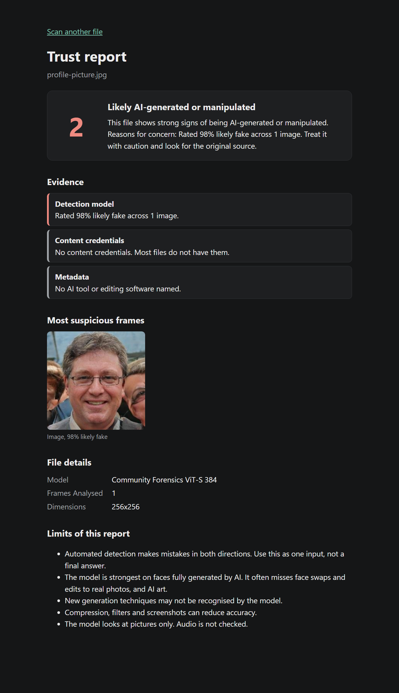 | 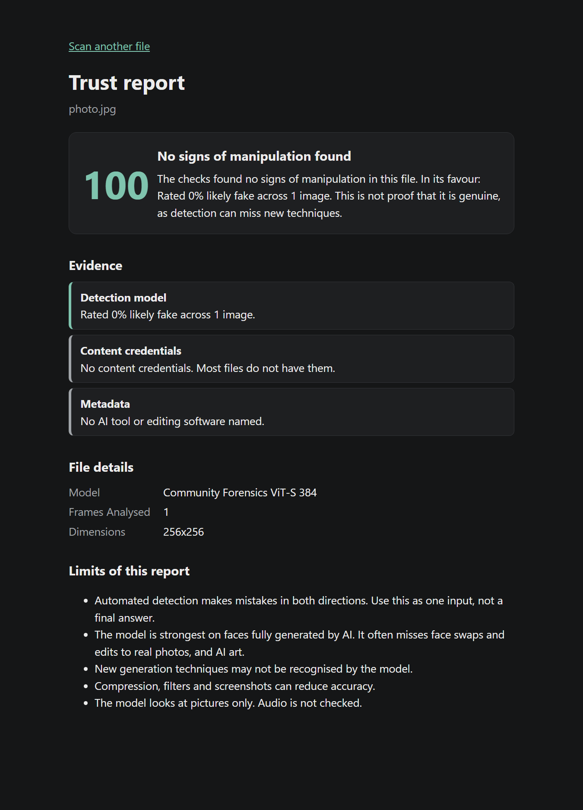 |

The face in the left report is labelled in its dataset as generated by StyleGAN.

## Contents

- [Project status](#project-status)
- [How it works](#how-it-works)
- [Architecture](#architecture)
- [Running on AWS](#running-on-aws)
- [Delivery pipeline](#delivery-pipeline)
- [Operations](#operations)
- [Problems I hit](#problems-i-hit)
- [Running locally](#running-locally)
- [The four checks](#the-four-checks)
- [Choosing the detector](#choosing-the-detector)
- [Results](#results)
- [Key decisions](#key-decisions)
- [Known limitations](#known-limitations)
- [Repository structure](#repository-structure)
- [Roadmap](#roadmap)
- [What I would improve next](#what-i-would-improve-next)
- [Credits](#credits)

## Project status

All five stages are built and have been proven on AWS. The application runs on one computer with LocalStack, and a GitHub Actions pipeline deploys the same code to AWS with signed images and blue/green releases. Workers scale to zero when idle, and alarms email me when something breaks.

The AWS environment is built on demand and destroyed after testing to avoid running costs, so there is no permanent public site. The screenshots below were taken from the live deployment.

## How it works

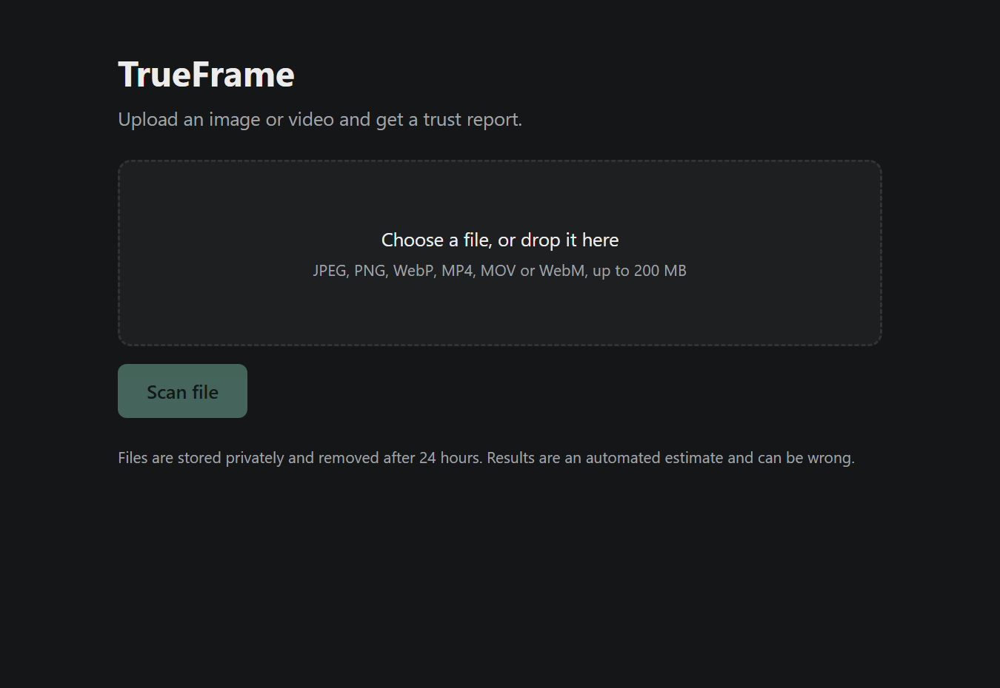

1. The API checks the file type from its first bytes, since a filename can say anything.
2. The file goes to S3 under a random ID, and DynamoDB records the scan as queued.
3. The API puts a job on the SQS queue and replies immediately.
4. The worker takes the job, scans the file for malware with ClamAV and runs the checks. A flagged file is rejected and never analysed.
5. The report is saved to DynamoDB, and the queue message is deleted only after success.
6. The report page polls the API until the result is ready.

If a worker dies partway through a job, the message reappears on the queue and another worker retries it. A job that fails three times moves to a dead-letter queue, so one bad file cannot block the others.

## Architecture

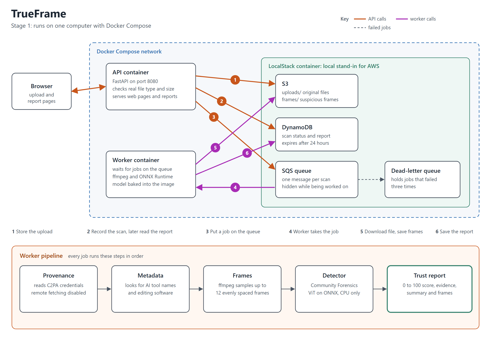

## Running on AWS

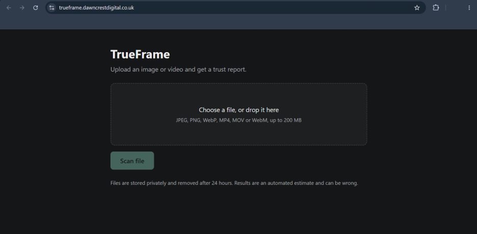

Terraform builds the whole environment, 73 resources in the London region, and can remove it again with one command.

| Part | How it is built | Why |
|---|---|---|
| Compute | Two ECS Fargate services on ARM64, one for the API and one for the worker | No servers to manage, and ARM costs less for the same work. |
| Network | Private subnets with VPC endpoints and no NAT gateway | The containers have no route to the internet, and the app's AWS traffic stays inside the VPC. |
| Entry point | Application Load Balancer with an ACM certificate | HTTPS only. Plain HTTP is redirected. |
| Firewall | WAF with a per-IP rate limit, IP reputation and known bad input rules | AWS's common rule set was left out because it blocks large file uploads. |
| Storage | S3, DynamoDB and SQS with a dead-letter queue | Uploads and scan records expire after one day. |
| Terraform state | S3 bucket with state locking, in its own small stack | The state survives when the main environment is destroyed. |
| Certificate | Separate stack, validated with DNS records at the domain registrar | DNS proof is set up once, however many times the environment is rebuilt. |

| ECS services running | Load balancer target healthy |
|---|---|
| 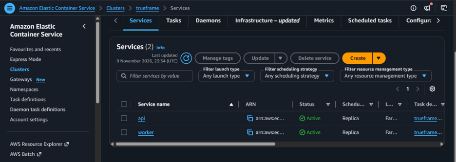 | 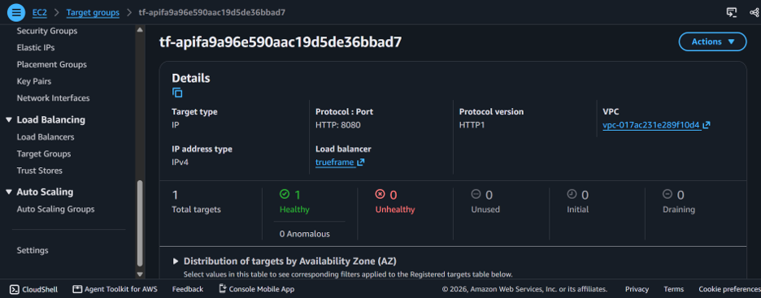 |

| Public and private subnets across two zones | WAF rules |
|---|---|
| 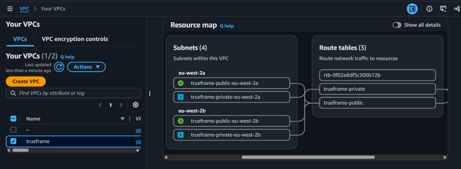 | 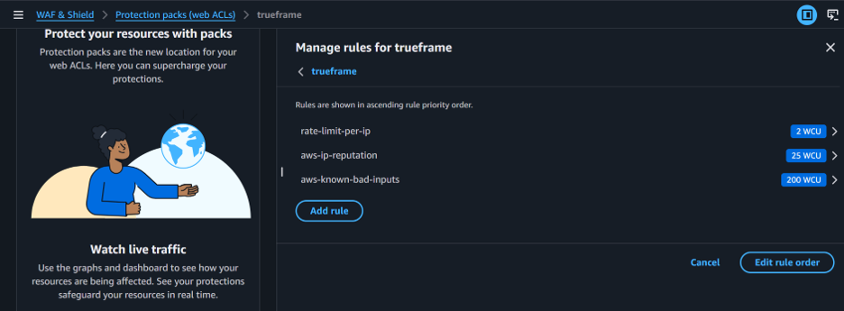 |

The deployed version was tested through the public address with the same pipeline as the local version.

| Input | Result on AWS |
|---|---|
| 12 real photos | All 12 scored 100. |
| 12 AI-generated faces | 7 flagged, 2 inconclusive and 3 wrongly passed. |
| Slideshow video of real faces | Score 100 |
| Slideshow video of AI-generated faces | Score 2 |

Images take about 1.1 seconds to scan on the Fargate worker. The environment costs roughly 10p an hour while it is running.

## Delivery pipeline

GitHub Actions tests, secures and ships every change. No AWS access keys are stored anywhere: each run proves its identity with a short-lived OIDC token.

| Workflow | Runs on | What it does |
|---|---|---|
| CI | Every pull request and push to main | Runs the tests, Terraform fmt and validate, tflint, Checkov, and a Trivy scan of dependencies and committed secrets. |
| Terraform plan | Pull requests that change `infra/` | Shows what would change on AWS using a read-only role, and comments the cost difference from Infracost. |
| Deploy | Started by hand from main | Creates or updates the environment, then ships the images. |
| Destroy | Started by hand, typing `destroy` to confirm | Removes the environment. |

A deployment goes through these steps, and any failure stops it:

1. Build the ARM images and scan them with Trivy. High or critical vulnerabilities with a fix available fail the build.
2. Push to ECR, sign each image with Cosign and attach its SBOM.
3. Verify the signatures. An image this workflow did not sign is refused.
4. Start the new API version beside the old one and move traffic only once it passes its health checks.
5. Keep the old version running for a bake period. If the new tasks never become healthy, or the error alarm fires, ECS moves traffic back automatically.
6. Confirm the expected version is really live, then check the health endpoint.

Both automatic rollback paths were tested on the live service.

| Drill | What happened |
|---|---|
| Release a version that crashes on start | It never received traffic. ECS rolled back on its own, about four minutes after the release began. |
| Release a healthy version, then fire the error alarm during the bake period | Rollback started within 13 seconds of the alarm and traffic was back on the old version a minute later. |

In both cases the service ended on the original version and the health endpoint returned 200. The alarm in the second drill was triggered by hand, to test the rollback rather than the alarm's threshold.

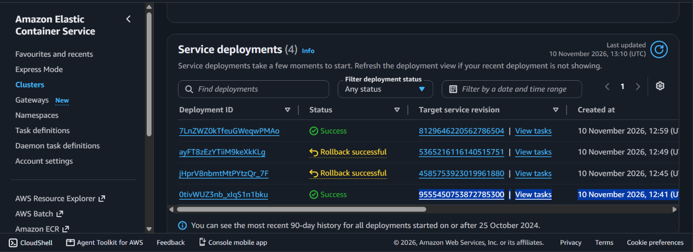

The pipeline's image scan also earned its place on the first run: it failed both images on a high-severity zlib vulnerability inherited from the Python base image, which led to the security update step in the Dockerfiles.

## Operations

### Scale to zero

Workers cost money only while they exist, so the worker service runs at zero when there is nothing to do. A CloudWatch alarm adds a worker when jobs are waiting, up to three, and another removes them all once the queue has been empty for ten minutes. Scans in progress count as work, so a worker is never removed mid-scan.

The API stays at one task, because something has to answer the upload request.

| Measured on AWS | Result |
|---|---|
| Idle workers removed after the queue emptied | 10 minutes 46 seconds |
| Upload to finished report with no workers running | 2 minutes 35 seconds |
| Of which, waiting for the queue metric to report | about 2 minutes |
| Same image with a worker already running | about 1 second to scan |

The wait on a cold start is the price of paying nothing while idle. On a brand-new environment the worker is removed after about a minute, because the new queue has no history and no data counts as idle.

### Monitoring and alarms

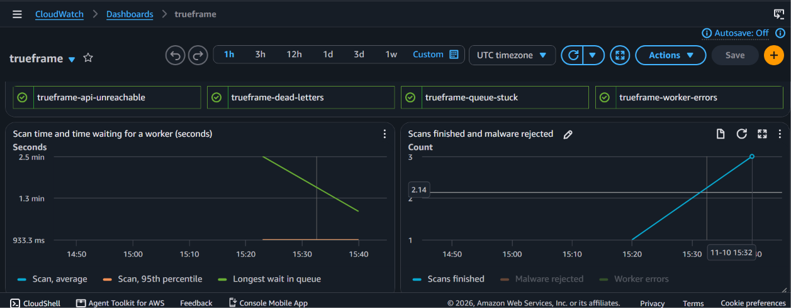

The worker writes its timings to its logs, and CloudWatch turns them into metrics. The dashboard shows scan time, queue wait, running workers, memory, API errors and an estimated cost per scan.

| Alarm | Fires when |
|---|---|
| Dead letters | A scan fails three times and leaves the main queue |
| Queue stuck | The oldest job has waited over 15 minutes |
| Worker errors | Three or more errors in five minutes |
| API unreachable | The load balancer cannot get an answer from the API |
| API 5xx | The API returns server errors, which also rolls back a release during its bake period |

The alert topic and a monthly $15 budget live in a permanent stack, so they keep watching after the application is destroyed. The budget ignores credits, otherwise credits would cancel out the spending and it would never warn. The dead-letter alarm was tested with a real message on the queue, and the action that sends the email ran and the alert email arrived.

### Chaos test

`scripts/chaos-test.sh` force-kills the workers during a scan, with three more jobs queued behind it. Normally a stopped worker gets two minutes to finish, so the script swaps in a copy that is killed after two seconds.

| Result | |
|---|---|
| Workers killed | 1, while a 183 MB video was being scanned |
| The three queued images | Finished within a minute, by the replacement worker |
| The interrupted video | Finished about six minutes after the kill |
| Jobs lost | 0 |
| Dead letters | 0 |

The video took longer because the queue hides a job for five minutes after a worker takes it. Only then does it reappear for another worker.

### Cost

| Item | Cost |
|---|---|
| Whole environment while running | about 10p an hour |
| Worker compute for one image, about 1 second | about $0.00001 |
| Worker compute for a 183 MB 4K video, about 58 seconds | about $0.0008 |
| Saved by not keeping a worker on all day | about $1.19 a day |

The per-scan figures count only the worker's time on that scan, using London Fargate ARM prices.

## Problems I hit

| Problem | Cause | Fix |
|---|---|---|
| GitHub could not sign in to AWS on the first pipeline run | GitHub now uses immutable IDs in its sign-in subject, which my trust policy did not match | Read the rejected subject in CloudTrail and matched it exactly |
| The image scan failed both images on its first run | A high-severity zlib flaw inherited from the base image | Added an OS upgrade to both image builds |
| The real ClamAV tests failed after switching branches on Windows | Git had converted a config file to Windows line endings, which ClamAV rejects | Forced Linux line endings for those files in `.gitattributes` |
| The worker scaled down after a minute instead of ten | A new queue has no metrics yet, and the alarm counts no data as idle | Kept it, since it saves money and the first upload wakes a worker |
| The same detector scored 0.985 from its authors' release but about 0.55 from a third-party copy | The third-party conversion did not behave like the original | Converted the authors' original weights myself and pinned a checksum |

## Running locally

You need Docker Desktop.

```bash
docker compose up --build
```

Then open http://localhost:8080.

Run the tests:

```bash
docker compose --profile test run --rm --build tests
```

Stop everything:

```bash
docker compose down
```

## The four checks

| Check | What it looks for | Effect on the score |
|---|---|---|
| Provenance | C2PA content credentials | Declared AI content caps the score at 10. Failed validation takes off 25. A trusted signer adds 15. |
| Metadata | AI tool names, Stable Diffusion settings and editing software | An AI tool name caps the score at 15. Editing software has no effect, because genuine media gets edited too. |
| Detection model | The probability that each frame is fake, across up to 12 evenly spaced frames | Sets the starting score, using the most suspicious third of the frames. |
| Scoring | All of the above | Below 40 is likely manipulated, 40 to 69 is inconclusive, and 70 or above means no signs were found. |

## Choosing the detector

The first model I tried advertised 92% accuracy, but it was close to a coin flip on images it had not seen. So I tested each candidate on the same labelled images.

AUC measures how well a model ranks fakes above real images, where 0.5 is a coin flip and 1.0 is perfect. Each cell is based on 200 images, half real and half fake.

| Model | AI-generated faces | Face swaps and edits | AI art |
|---|---|---|---|
| **Community Forensics, original weights (used)** | **0.985** | 0.49 | 0.74 |
| UniversalFakeDetect | 0.85 | 0.64 | 0.94 |
| deepfake_vs_real_image_detection | 0.60 | 1.00 (see note) | 0.98 |
| GenD | 0.56 | 0.66 | not tested |
| Community Forensics, third-party ONNX copy | 0.55 | 0.53 | 0.41 |
| Deep-Fake-Detector-v2 | 0.47 | 0.10 | 0.07 |
| AI-vs-Deepfake-vs-Real | 0.28 | 0.41 | 0.99 |

Note: that perfect score probably means the model was trained on very similar images, so I did not rely on it.

The clearest lesson was that the same model scored 0.985 from its authors' release and about 0.55 from a third-party conversion. Published accuracy figures need checking against data you control.

## Results

These were run through the full upload, queue, worker and report path, on a separate random sample of real photos and StyleGAN faces.

| Input | Result |
|---|---|
| 60 real photos | Average score 99.8. All 60 reported no signs of manipulation. |
| 60 AI-generated faces | Average score 32.1. 41 flagged, 4 inconclusive and 15 wrongly passed. |
| Slideshow video of real faces | Score 100 |
| Slideshow video of AI-generated faces | Score 2 |

Images take about 0.4 seconds to scan on a laptop CPU.

### Accuracy on public datasets

I then measured the detector alone on held-out splits of three public datasets, using the real scoring rule and single images. Run it with `evals/detector_eval.py`. The raw figures are in `evals/results/detector.json`.

| Dataset | Images | AUC | Fakes flagged | Fakes given "no signs found" | Real images wrongly flagged |
|---|---|---|---|---|---|
| [140k Real and Fake Faces](https://huggingface.co/datasets/TheKernel01/140k-Real-and-Fake-Faces) (StyleGAN) | 500 fake, 500 real | 0.999 | 99.8% | 0% | 2.2% (1.2 to 3.9) |
| [Celeb-DF image copy](https://huggingface.co/datasets/thenewsupercell/celeb-df-image-dataset) (manipulated video frames) | 500 fake, 180 real | 0.71 | 0.4% (0.1 to 1.5) | 99.4% | 0% (0 to 2.1) |
| [Face swap set](https://huggingface.co/datasets/kenjon/deep-fake-face-swap) (fakes only) | 500 fake | not possible | 1.6% (0.8 to 3.1) | 97.8% | not possible |

Figures in brackets are 95% ranges.

**What this shows:** the detector works on fully AI-generated faces and almost never flags a face swap or a manipulated video frame. On those, nearly every fake gets the most reassuring verdict the system can give. A clean report says very little about this kind of deepfake.

**How far to trust these numbers:**

- The StyleGAN result is better than the end-to-end test above, where 41 of 60 AI-generated faces were flagged. I have not explained that gap, and the model may have trained on this generator, so 99.8% should not be read as its general accuracy.
- The Celeb-DF and face swap files are community uploads with little documentation. The face swap labels come from file names.
- Frames from the same video are probably not independent, so the Celeb-DF ranges are likely too narrow.
- The thresholds were not tuned on this data. Tuning them on it would make the numbers look better without showing the detector had improved.

## Key decisions

| Decision | Why |
|---|---|
| Queue and separate worker | Slow analysis cannot tie up the website, and workers can scale with demand. |
| Average the most suspicious third of frames | A plain average would let a short faked section hide among normal footage. |
| ONNX Runtime instead of PyTorch at runtime | PyTorch is only used during the image build, which keeps it out of the final image. |
| Pinned model revision and checksum | Every build gets exactly the same weights, and the build fails if they change. |
| A valid signature earns no bonus without a trust list | Anyone can sign a file, so a signature alone only proves it has not changed since signing. |
| Remote C2PA manifests are never fetched | An uploaded file must not be able to make the worker request an address of its choosing. |
| Reports never call a file genuine | The strongest verdict is "no signs of manipulation found". |
| ECS built-in blue/green instead of CodeDeploy | AWS now recommends it, and Terraform can stay in charge of what is deployed. |
| Separate roles for pull requests and for main | A pull request can only read. Only a workflow running from main can change anything. |
| Actions pinned to commit hashes | Version tags can be moved. In March 2026 attackers rewrote almost every tag of a widely used scanner action. |
| Image scan runs before AWS credentials exist | A compromised scanner would have nothing to steal. |
| Keyless image signing | The workflow's GitHub identity is the proof, so there is no private key to protect. |
| Some Checkov findings are accepted | Each one has a written reason in `.checkov.yaml` or next to the resource. |
| Workers scale to zero, the API does not | Workers can wait for a job, but an upload needs something to answer it straight away. |
| Budget ignores credits | Credits would otherwise cancel out the spending and hide it. |
| Malware scan runs before any parser | Decoding a hostile file is the risky step, so the scan has to come first. |
| No scanner answer means no analysis | If ClamAV is down or times out, the job goes back on the queue rather than skipping the check. |
| ClamAV signatures are baked into the image | The worker has no internet access, so it cannot download updates at runtime. |

## Known limitations

- **Face swaps and manipulated video are the biggest gap.** The detector flagged under 2% of them across two public datasets and gave almost all of the rest "no signs found". No model tried so far reached a useful level.
- **Around 1 in 4 AI-generated faces passed** in the end-to-end test.
- **AI art is mostly missed** at the default threshold.
- **The evidence has gaps.** Most of the fake faces come from one generator, the public figures use single images, and the end-to-end test videos are slideshows of still images rather than real footage.
- **A cold start takes a few minutes.** With no workers running, the first scan took about 2.5 minutes, mostly waiting for the queue metric.
- **Audio is not analysed.**
- **No C2PA trust list is configured yet,** so signatures are checked for integrity but signers are not verified.
- **The malware scan has limits.** ClamAV's signatures are only as fresh as the last deploy, and it will not reliably catch a file built to exploit a bug in an image or video parser. The worker's network limits and non-root user are the defence against that.
- **Local uploads are not deleted automatically.** The AWS version deletes them after one day.

## Repository structure

```text
trueframe/
  app/
    api/          upload, results and health endpoints
    shared/       settings, AWS connections, scan records
    web/          upload and report pages
    worker/       queue handling and the analysis pipeline
  docs/
    screenshots/  images used in this README
  .github/        CI, plan, deploy and destroy workflows
  infra/          Terraform: network, storage, edge, compute and ops modules
    bootstrap/    state bucket
    certificate/  HTTPS certificate
    cicd/         GitHub sign-in to AWS and the pipeline's roles
  scripts/        pushes images by hand, verifies a release and runs the chaos test
  localstack/     creates the local bucket, queues and table
  tests/          unit and end-to-end tests
  evals/          measures the detector on public datasets
  docker-compose.yml
```

## Roadmap

- [x] Stage 1: application running locally
- [x] Stage 2: AWS with Terraform (ECS Fargate, private networking with VPC endpoints, load balancer, HTTPS, WAF)
- [x] Stage 3: CI/CD and security (GitHub Actions with OIDC, Trivy, Checkov, signed images, SBOMs, blue/green deployments)
- [x] Stage 4: malware scanning of every upload with ClamAV, plus a full evaluation on public datasets
- [x] Stage 5: operations (scale to zero, dashboards, alarms, chaos testing, budget alerts)
- [ ] Demo video

## What I would improve next

- **Catch face swaps.** This is the biggest weakness. I would test models built for face swaps and only add one that holds up on data it has not seen.
- **Add a second model for AI art.** UniversalFakeDetect scored 0.94 AUC on AI art in my tests, against 0.74 for the current model.
- **Explain the StyleGAN gap.** The public dataset result was far better than the end-to-end test, and I want to know why before relying on either number.
- **Test on real video.** The end-to-end videos are slideshows, and the public figures use single frames.
- **Start workers faster.** Most of a cold start is waiting for the queue metric. The API could request a worker directly when a job arrives.
- **Keep malware signatures fresh.** A scheduled rebuild would stop them ageing between deploys.
- **Add a C2PA trust list,** so signatures from known cameras and tools can earn trust.
- **Analyse audio,** which is not checked at all.
- **Detect drift.** A scheduled Terraform plan would show if AWS stops matching the code.

## Credits

- Detection model: [Community Forensics](https://github.com/JeongsooP/Community-Forensics), Park and Owens, CVPR 2025, MIT licence.
- Evaluation data came from public datasets on Hugging Face, including [140k Real and Fake Faces](https://huggingface.co/datasets/TheKernel01/140k-Real-and-Fake-Faces).
